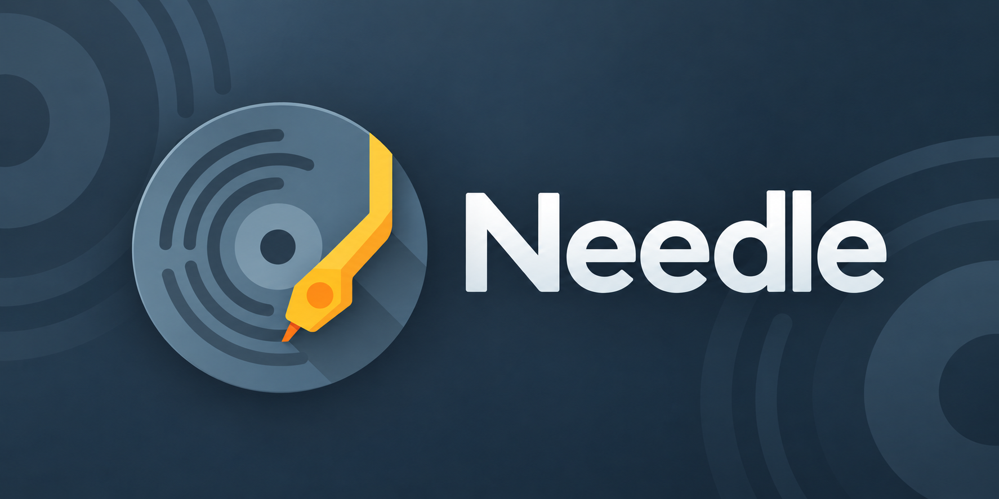

# Needle Music Player



**Needle** is an open-source local music player for Android 14 and newer,
independently forked from
[Vinyl Music Player](https://github.com/VinylMusicPlayer/VinylMusicPlayer),
which is based on [Phonograph](https://github.com/kabouzeid/Phonograph).

Features include Android Auto, ReplayGain, playlists, widgets and tag editing.

## Project

- [Source and issues](https://github.com/omblivion/VinylMusicPlayer)
- [Privacy](PRIVACY.md)
- [License: GPL v3](LICENSE.txt)
- [Changelog](CHANGELOG.md)

Needle uses application ID `io.github.omblivion.needle` and can be installed beside
Vinyl. Each app has its own settings, database, widgets and shortcuts. Music files
are shared: editing tags or deleting files in either app affects both libraries.
There is no Needle Google Play or F-Droid listing configured in this repository.

## Build

Requires JDK 17 and Android SDK platform 37 (compile/target SDK 37, minimum SDK 34).
Set `JAVA_HOME` and `ANDROID_HOME`, or configure the SDK path in your untracked
`local.properties`.

```sh
./gradlew testFdroidDebugUnitTest assembleFdroidDebug assembleFdroidRelease lintFdroidDebug
```

On Windows use `gradlew.bat`. Debug builds need no release credentials and use the
`.debug` application ID suffix. Release signing is optional and configured with an
untracked `keystore.properties`. CI validates builds and tests; it does not publish
to any store.

## Attribution

Original authors, contributors, licenses and upstream issue links are retained.
The bundled credits describe the original projects' contributors.

Needle launcher artwork and banner are supplied with this fork in `art/`.
Original upstream icon by [Nikita Golubev](https://www.flaticon.com/authors/nikita-golubev)
from www.flaticon.com. Album image by
[Virginia State Parks](https://www.flickr.com/photos/vastateparksstaff/38645226714/)
(CC BY 2.0).
